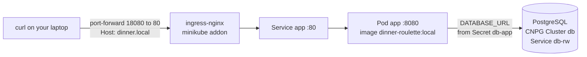
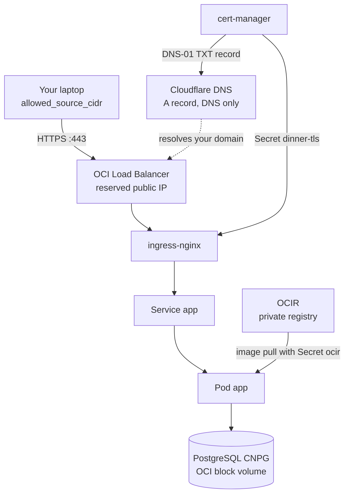

# Dinner Roulette on Kubernetes

This guide takes the Dinner Roulette API from your laptop to the cloud, one step at a time. You will run the same application, with the same Kubernetes manifests, in two places:

- **minikube**, a single-node Kubernetes cluster on your own machine, with plain HTTP and a locally built image.
- **OKE** (Oracle Cloud Infrastructure Kubernetes Engine), a managed cluster on Oracle Cloud, with a private image registry, a load balancer on a fixed public IP, a real domain and a Let's Encrypt certificate.

Every step tells you **what to run**, explains **what happens behind the scenes**, and shows **how to check** that it worked. When something breaks, the [Troubleshooting](troubleshooting.md) page lists the errors that were actually hit while this setup was built, with their causes and fixes.

!!! tip "All commands run from `infra/`"
    The `Makefile` that drives everything lives in `infra/`. Either `cd infra` first, or run `make -C infra <target>` from the repository root. Running `make` with no target lists every target with a one-line description.

## The application in one minute

Dinner Roulette is a small TypeScript/Express API used in a [12-Factor App](https://12factor.net/) coding dojo. It suggests where to have dinner, based on votes.

| Endpoint | What it does |
|---|---|
| `POST /votes` | Adds a vote to a restaurant. Body: `{"user": "alice", "restaurantId": "sakura"}` |
| `GET /suggestion` | Returns the most voted restaurant, picked at random on ties |
| `GET /health` | Always returns `{"status":"ok"}` |
| `GET /version` | Returns the commit SHA baked into the image at build time |

It listens on port `8080` and reads one setting from the environment: `DATABASE_URL`. Restaurants and their vote counters live in PostgreSQL, created and seeded by [`db/init.sql`](https://github.com/mlazzarotto/dinner-roulette-12-factor-to-the-cloud/blob/main/db/init.sql) (three restaurants: `sakura`, `napoli`, `trattoria`).

## What you will build

### On minikube



Everything runs inside one Docker container (the minikube "node"). The image is built on your machine and copied into minikube, so nothing is pulled from a registry. There is no TLS: you reach the app through a temporary port-forward.

### On OKE



Terraform creates the network and the cluster. Helm installs the cluster add-ons. The manifests deploy the app and its database. OKE itself then creates the load balancer and the disk that the manifests ask for. Only your own IP address can reach the Kubernetes API and the website.

## Same manifests, two environments

Both environments share `infra/k8s/base`. The differences live in small overlays and in how the cluster is created:

| Aspect | minikube | OKE |
|---|---|---|
| Cluster | One node, inside Docker on your laptop | Managed control plane plus one worker VM |
| Created by | `minikube start` | Terraform (`infra/tf/`) |
| Image | Built locally, loaded with `minikube image load`, never pulled | Pushed to OCIR, pulled with the `ocir` Secret |
| Entry point | Ingress addon, reached through a port-forward | ingress-nginx behind an OCI Load Balancer |
| Hostname | `dinner.local`, sent as a `Host` header | Your real domain |
| TLS | None | Let's Encrypt, issued through Cloudflare DNS-01 |
| Postgres storage | minikube's `standard` storage class | OCI block volume (`oci-bv`, 50 GB minimum) |
| Who can reach it | Only your machine | Only `allowed_source_cidr` |
| Cost | Free | Free control plane. The node, load balancer and disk may be free or paid, see [costs](oke/index.md#what-it-costs) |

## How to use this guide

1. **[Concepts](concepts.md)** explains the Kubernetes objects, Kustomize, Helm, the operators and the 12-Factor ideas behind the setup. Skim it if you already know Kubernetes.
2. **[Prerequisites](prerequisites.md)** lists the tools to install and how to check them.
3. **[minikube](minikube.md)** runs the whole stack locally. It takes about 15 minutes and needs no cloud account. Start here even if your goal is OKE: you get familiar with every moving part without paying for anything.
4. **[OKE](oke/index.md)** has seven steps. The first time, expect one to two hours, most of it on account, registry and DNS setup that you only do once. After that, `make oke-up` brings everything up in about 20 minutes, and `make oke-down` removes it.
5. **[Troubleshooting](troubleshooting.md)** and **[Reference](reference.md)** are for when you need them.

## Repository map

```text
.
├── src/, test/              # the API and its tests
├── db/init.sql              # schema and seed data, run once by CloudNativePG
├── Dockerfile               # multi-stage build: tests and tsc, then a slim runtime image
├── docker-compose.yml       # plain Docker alternative, no Kubernetes involved
├── .githooks/pre-commit     # blocks secrets and Terraform state, runs the tests
├── .github/workflows/
│   ├── build.yml            # tests, then multi-arch image pushed to OCIR (on push to main)
│   ├── deploy.yml           # manual deploy to OKE
│   └── pages.yml            # publishes this guide
├── docs/                    # this guide (MkDocs Material)
└── infra/
    ├── Makefile             # every command used in this guide
    ├── .secrets.example     # template for infra/.secrets.env (git-ignored)
    ├── tf/                  # Terraform: network, OKE cluster, node pool
    └── k8s/
        ├── base/            # namespace, app Deployment and Service, CNPG Cluster
        ├── overlays/
        │   ├── minikube/    # local image, no pull secret, HTTP ingress
        │   └── oke/         # TLS ingress for the public domain
        └── clusterissuer.yaml   # Let's Encrypt with Cloudflare DNS-01
```

!!! info "About the example values"
    The repository is currently configured for the domain `dinner.alessandroperetti.dev` in the `eu-milan-1` region. This guide uses placeholders such as `dinner.example.com`, `203.0.113.10` and `<tenancy-namespace>`, and tells you exactly which files to change for your own account and domain.
