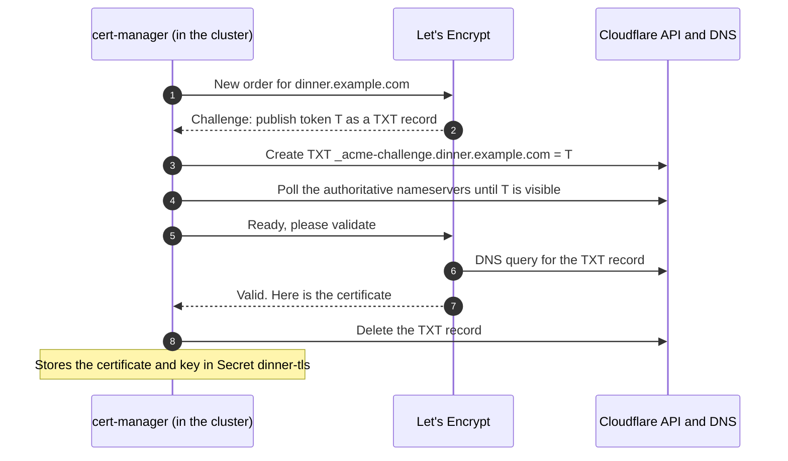

# Step 2: Domain, DNS and TLS

At the end of this step, your hostname resolves to the reserved IP, and you have a Cloudflare API token that cert-manager can use to prove to Let's Encrypt that you control the domain.

**Time:** 15 minutes of work, plus waiting for nameserver changes if the domain is new to Cloudflare. That can take from minutes to a few hours.

## How the certificate is obtained

Let's Encrypt issues a certificate only after you prove that you control the domain. There are two common ways to prove it:

- **HTTP-01**: Let's Encrypt fetches a token from `http://<domain>/.well-known/acme-challenge/…`. That needs port 80 open to the whole internet.
- **DNS-01**: you publish a token in a TXT record `_acme-challenge.<domain>`, and Let's Encrypt reads it through DNS. No inbound connection to the cluster is needed.

This setup uses **DNS-01**, which is why the load balancer accepts only your IP on 443 and keeps port 80 closed. Cloudflare hosts the DNS zone, and cert-manager uses Cloudflare's API to create and delete the TXT record by itself.



Cloudflare is used **only for DNS**. It does not proxy the traffic and does not terminate TLS. Visitors connect straight to the OCI load balancer, and nginx in the cluster serves the Let's Encrypt certificate.

## 2.1 Get a domain into Cloudflare

You need a domain whose DNS you control. Adding a site to Cloudflare does **not** buy the domain: register it with a registrar first.

1. Register the domain with any registrar, or use one you already own.
2. In the Cloudflare dashboard: **Add a domain** → enter the apex domain (for example `example.com`) → choose the **Free** plan.
3. Cloudflare shows two nameservers, such as `dina.ns.cloudflare.com` and `razvan.ns.cloudflare.com`. In your **registrar's** control panel, replace the domain's nameservers with these two. This is done at the registrar, not in Cloudflare and not in the repository.
4. Wait until the zone status in Cloudflare changes from **Pending** to **Active**.

Check from your terminal:

```bash
dig +short NS example.com
# dina.ns.cloudflare.com.
# razvan.ns.cloudflare.com.
```

A subdomain of a zone you already have on Cloudflare (for example `dinner.example.com`) works just as well, and needs no nameserver change.

## 2.2 Create the A record

In Cloudflare: your zone → **DNS** → **Records** → **Add record**:

| Field | Value |
|---|---|
| Type | `A` |
| Name | `@` for the apex domain, or a label such as `dinner` for `dinner.example.com` |
| IPv4 address | Your **reserved IP** from [step 1.7](oci-account.md#17-reserve-a-public-ip) |
| Proxy status | **DNS only** (grey cloud) |
| TTL | Auto |

!!! danger "The cloud must be grey"
    With the orange cloud (**Proxied**), visitors connect to Cloudflare's servers and Cloudflare connects to your load balancer. The `dinner-lb` NSG accepts only `allowed_source_cidr`, so it drops every connection coming from Cloudflare, and the site times out. Switch the record to **DNS only**.

The record can be created before the cluster exists. It will simply point at an address where nothing answers yet.

```bash
dig +short A dinner.example.com
# 203.0.113.10      ← must be the reserved IP, not a Cloudflare address
```

## 2.3 Create the Cloudflare API token

cert-manager needs a token that can edit DNS records in this zone, and nothing else.

1. Cloudflare dashboard → **My Profile** → **API Tokens** → **Create Token**.
2. Start from the **Edit zone DNS** template, or choose **Create Custom Token**.
3. **Permissions**, two rows:
    - **Zone → DNS → Edit**
    - **Zone → Zone → Read**
4. **Zone Resources**: **Include → Specific zone → `example.com`**.
5. **Continue to summary** → **Create Token**, then copy the token. Cloudflare shows it only once.

!!! warning "Common mistakes with the token"
    - **"DNS Settings" is not "DNS".** The *DNS Settings* permission controls zone-level settings, not records. You need **Zone → DNS → Edit**.
    - **The zone must be in the token's resources.** A token that is active but lists no zones can authenticate, but cannot find your domain.
    - **The right account.** The zone list only shows zones of the account you are logged in to. If your domain is missing, you are probably logged in to another Cloudflare account.

Check the token. Both calls must succeed:

```bash
export CLOUDFLARE_API_TOKEN=<token>

curl -s -H "Authorization: Bearer $CLOUDFLARE_API_TOKEN" \
  https://api.cloudflare.com/client/v4/user/tokens/verify
# ..."status":"active"... "message":"This API Token is valid and active"

curl -s -H "Authorization: Bearer $CLOUDFLARE_API_TOKEN" \
  "https://api.cloudflare.com/client/v4/zones?name=example.com" | grep -o '"name":"[^"]*"' | head -1
# "name":"example.com"      ← empty output means the token cannot see the zone
```

## 2.4 Choose the ACME email

`ACME_EMAIL` is the contact address of your Let's Encrypt account. Use a real address you own. Let's Encrypt rejects placeholder domains such as `example.com`, so the `you@example.com` value from `.secrets.example` makes the ClusterIssuer fail.

## 2.5 What cert-manager will do with all this

You do not run anything in this step: `make oke-up` does it in [step 5](provision.md). It is useful to know the pieces, though, because this is what you inspect when a certificate does not appear.

`make oke-up` stores the token in the Secret `cloudflare-api-token`, in the `cert-manager` namespace. It then replaces `__ACME_EMAIL__` in this file and applies it:

```yaml title="infra/k8s/clusterissuer.yaml"
--8<-- "infra/k8s/clusterissuer.yaml"
```

- A **ClusterIssuer** is a certificate authority configuration that every namespace can use.
- `server` is Let's Encrypt's production endpoint. Its certificates are trusted by browsers.
- `privateKeySecretRef` is where cert-manager keeps the private key of your ACME **account**. That is not the key of the certificate.
- `solvers.dns01.cloudflare` says: solve challenges by writing TXT records through Cloudflare, with the token from the Secret.

The OKE Ingress carries the annotation `cert-manager.io/cluster-issuer: letsencrypt-cloudflare` and a `tls` block with `secretName: dinner-tls`. cert-manager reacts to it by creating a chain of objects in the `dinner` namespace:

```text
Ingress app ─▶ Certificate dinner-tls ─▶ CertificateRequest ─▶ Order ─▶ Challenge (one per host name)
                     │
                     └─▶ Secret dinner-tls (tls.crt + tls.key), served by ingress-nginx
```

cert-manager renews the certificate automatically about 30 days before it expires, which matters only if the cluster lives that long.

!!! warning "Let's Encrypt rate limits"
    Every `oke-down` deletes the certificate, and every `oke-up` requests a new one for the same host name. Let's Encrypt allows **5 certificates for the exact same set of host names every 7 days**. If you cycle the cluster more often than that, issuance stops with a `rateLimited` error until the window passes. While you experiment, switch `server` in `infra/k8s/clusterissuer.yaml` to the staging endpoint, `https://acme-staging-v02.api.letsencrypt.org/directory`. Its limits are much higher, but browsers do not trust its certificates, so use `curl -k` to test.

## 2.6 Use your hostname in the repository

The repository is configured for `dinner.alessandroperetti.dev`. Replace it with your host name in two files:

| File | Where |
|---|---|
| `infra/k8s/overlays/oke/ingress.yaml` | `tls[0].hosts` and `rules[0].host` |
| `infra/Makefile` | The `Ready:` message at the end of `oke-up`, and the URL in `oke-smoke` |

Find and replace from the repository root:

=== "Linux"

    ```bash
    grep -rln 'dinner\.alessandroperetti\.dev' infra/ | xargs sed -i 's/dinner\.alessandroperetti\.dev/dinner.example.com/g'
    grep -rn 'dinner.example.com' infra/
    ```

=== "macOS"

    ```bash
    grep -rln 'dinner\.alessandroperetti\.dev' infra/ | xargs sed -i '' 's/dinner\.alessandroperetti\.dev/dinner.example.com/g'
    grep -rn 'dinner.example.com' infra/
    ```

The second command should list two lines in the Ingress and two in the `Makefile`, plus comments in `infra/README.md` and `infra/.secrets.example`, which the replacement updates as well.

## Checklist

- [x] `dig +short NS <zone>` shows Cloudflare's nameservers
- [x] `dig +short A <host>` returns the reserved IP, with the record set to **DNS only**
- [x] the Cloudflare token verifies and can see the zone
- [x] a real `ACME_EMAIL`
- [x] your host name in `ingress.yaml` and in the `Makefile`

Next: [Step 3: Configure the repository](configure.md).
