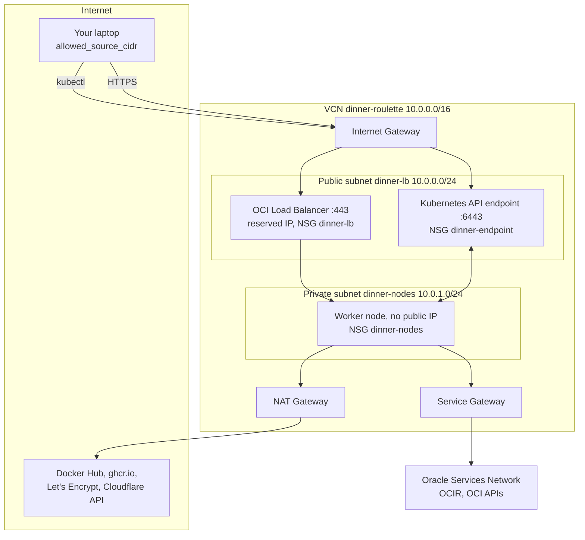

# Run it on OKE

OKE (Oracle Cloud Infrastructure Kubernetes Engine) is Oracle's managed Kubernetes. Oracle runs the control plane (API server, etcd, scheduler) for you. You get an API endpoint and a pool of worker VMs that run your pods.

This section takes you from an empty Oracle Cloud account to `https://<your-domain>/suggestion` answering over HTTPS, and back to nothing when the session is over.

## The seven steps

Steps 1 to 4 are done **once**. Steps 5 to 7 are the cycle you repeat for every session.

| Step | What you do | Result |
|---|---|---|
| [1. Oracle Cloud account](oci-account.md) | API key, auth token, reserved IP, your source IP | Terraform, the OCI CLI and Docker can talk to Oracle |
| [2. Domain and TLS](dns-tls.md) | Cloudflare zone, A record, API token | A hostname pointing at your reserved IP, and a token for cert-manager |
| [3. Configure the repository](configure.md) | `infra/.secrets.env`, `infra/tf/prod.tfvars`, the hostname | The repository describes your account and domain |
| [4. Publish the image](image.md) | Push the app image to OCIR | An image the cluster can pull |
| [5. Bring it up](provision.md) | `make oke-up` | Cluster, add-ons, database and app, about 20 minutes |
| [6. Day-2 operations](operate.md) | Status, redeploys, logs, database, IP changes, CI | A running service you can change |
| [7. Tear it down](teardown.md) | `make oke-down` | Back to the reserved IP and the images only |

The stack is designed to be **ephemeral**: you create it before a workshop session and destroy it afterwards. Only the reserved public IP, the images in the registry and your DNS record survive between sessions, so the hostname never changes.

## Who creates what

Three layers of tooling create the resources, and OKE itself creates two more in response to what the manifests ask for.

| Resource | Created by | Removed by | Survives `oke-down` |
|---|---|---|---|
| VCN, gateways, subnets, route tables, security list, NSGs | Terraform (`infra/tf/network.tf`) | `terraform destroy` | No |
| OKE Basic cluster and node pool | Terraform (`infra/tf/cluster.tf`) | `terraform destroy` | No |
| cert-manager, ingress-nginx, ClusterIssuer, Cloudflare Secret | `make oke-up` (Helm and kubectl) | Deleted with their namespaces | No |
| CNPG operator, `ocir` Secret, `db-init`, app manifests | `make oke-deploy` | Deleted with their namespaces | No |
| **OCI Load Balancer** | OKE's cloud controller manager, for the ingress-nginx `LoadBalancer` Service | The cloud controller manager, when the Service is deleted | No |
| **Block volume** for PostgreSQL | OKE's CSI driver, for the PVC `db-1` | The CSI driver, when the PVC is deleted | No |
| TLS certificate | cert-manager | Deleted with the cluster, issued again on the next `oke-up` | No |
| Reserved public IP | You, once, with the OCI CLI | You | **Yes** |
| Images in OCIR | CI or `make oke-push` | You | **Yes** |
| DNS record, Cloudflare token | You, once | You | **Yes** |
| Terraform state (`infra/tf/terraform.tfstate`) | Terraform, on your laptop | Never delete it | **Yes** |

The two rows in bold are the reason why `make oke-down` deletes the Kubernetes workloads **before** running `terraform destroy`. Terraform does not know about the load balancer or the block volume. If the cluster disappeared first, nobody would be left to delete them: the load balancer would block the deletion of its subnet, and the volume would keep costing money.

## The network



- **Public subnet** `10.0.0.0/24` holds the Kubernetes API endpoint (with a public IP) and the load balancer. Its route table sends `0.0.0.0/0` to the Internet Gateway. Its security list is **empty on purpose**, so the only thing that admits traffic is the NSGs below.
- **Private subnet** `10.0.1.0/24` holds the worker node, which has no public IP. Outbound internet traffic (Docker Hub, `ghcr.io`, Let's Encrypt, the Cloudflare API) goes through the NAT Gateway. Traffic to Oracle services such as OCIR goes through the Service Gateway and never leaves Oracle's network.
- **Flannel overlay** (`FLANNEL_OVERLAY`) gives pods addresses from an internal overlay network, not from the VCN. It is the simpler of OKE's two pod networking options, and it is supported by Basic clusters.

### Security rules

All filtering is done with three Network Security Groups (NSGs), which are attached to specific resources rather than to whole subnets.

| NSG | Direction | Peer | Ports | Why |
|---|---|---|---|---|
| `dinner-endpoint` | in | `allowed_source_cidr` | TCP 6443 | `kubectl` from your laptop, and from nowhere else |
| `dinner-endpoint` | in | node subnet | TCP 6443, 12250 | Nodes register with the control plane. Without these rules the node pool fails with "node(s) register timeout" |
| `dinner-endpoint` | out | `dinner-nodes` | all | API server to kubelet (10250) for `logs`, `exec` and `port-forward` |
| `dinner-endpoint` | out | `0.0.0.0/0` | TCP 443 | The control plane calls OCI APIs. Without it, nodes keep the `uninitialized` taint |
| `dinner-nodes` | in | `dinner-endpoint` | all TCP | Control plane to kubelet |
| `dinner-nodes` | in | node subnet | all | Node to node, including the Flannel overlay |
| `dinner-nodes` | in | `dinner-lb` | all | Load balancer to the NodePorts, and to the health check port 10256 |
| `dinner-nodes` | out | `0.0.0.0/0` | all | Image pulls, ACME, Cloudflare, OCI APIs |
| `dinner-lb` | in | `allowed_source_cidr` | TCP 443 | HTTPS from you only. **Port 80 stays closed** |
| `dinner-lb` | out | `dinner-nodes` | all | Load balancer to its backends |

Port 80 can stay closed because the certificate is validated through DNS (DNS-01), not through an HTTP request to the site. The load balancer still has a listener on port 80, because ingress-nginx's Service exposes it, but no NSG rule lets traffic reach it.

## The path of a request

When you run `curl https://dinner.example.com/suggestion`:

1. Your resolver asks Cloudflare for `dinner.example.com` and gets the **reserved IP** directly. The record is "DNS only", so Cloudflare does not proxy the traffic.
2. Your TCP connection reaches the **OCI Load Balancer** on port 443. The `dinner-lb` NSG lets it through only if your IP matches `allowed_source_cidr`.
3. The load balancer forwards the TCP stream, still encrypted, to the ingress-nginx **NodePort** on the worker node. It health-checks the node on kube-proxy's port 10256.
4. kube-proxy hands the connection to the **ingress-nginx** pod. nginx terminates TLS with the certificate from the `dinner-tls` Secret, matches the host name against the Ingress rule, and proxies the request to the `app` Service.
5. The **app** pod handles the request and queries PostgreSQL through `db-rw:5432`. The database files live on an OCI **block volume** attached to the node.

## What `make oke-up` does, at a glance

| Phase | What happens | Rough duration |
|---|---|---|
| Terraform, network | VCN, gateways, subnets, NSGs and rules | about 1 min |
| Terraform, cluster | Control plane is provisioned by Oracle | 7 to 10 min |
| Terraform, node pool | Worker VM boots and joins the cluster | 5 to 10 min |
| kubeconfig | `infra/kubeconfig`, context `oke` | seconds |
| cert-manager | Helm install, CRDs included | 1 to 2 min |
| ingress-nginx | Helm install, then OCI creates the load balancer on your reserved IP | 2 to 4 min |
| ClusterIssuer | Cloudflare token Secret, ACME account registration | under 1 min |
| `oke-deploy` | Namespace, pull secret, CNPG, database volume, app rollout | 3 to 5 min |

About 20 minutes from nothing. Running it again on an existing cluster takes a few minutes, because Terraform finds nothing to change.

## What it costs

!!! warning "Check current prices"
    Oracle changes its free tier and prices from time to time. The figures below were correct in October 2026. Check [Always Free resources](https://docs.oracle.com/en-us/iaas/Content/FreeTier/freetier_topic-Always_Free_Resources.htm) and [OKE pricing](https://www.oracle.com/cloud/cloud-native/kubernetes-engine/pricing/) before you rely on them.

**Control plane: free.** The cluster is a **Basic** cluster (`type = "BASIC_CLUSTER"`), and Oracle does not charge for its control plane. Enhanced clusters cost $0.10 per hour and add features this setup does not need: virtual nodes, managed add-ons, workload identity and a financially backed SLA.

**Worker node: free or paid, depending on the shape.**

- `VM.Standard.A1.Flex` (Ampere, arm64) is covered by Always Free up to **2 OCPUs and 12 GB of memory in total per tenancy**, in your **home region** only. It used to be 4 OCPUs and 24 GB; Oracle has enforced the lower limit since 18 August 2026. The repository's default (`variables.tf`: 2 OCPUs, 12 GB) uses exactly that allowance. A1 capacity is often exhausted, though, and then the node pool cannot be created. See [Troubleshooting](../troubleshooting.md#node-pool-fails-with-work-request-exceeded-max-retry-count).
- `VM.Standard.E3.Flex`, `E4.Flex` and `E5.Flex` (AMD, amd64) are paid and usually available. `infra/tf/prod.tfvars` currently uses `E3.Flex` with 1 OCPU and 8 GB for that reason.

**Storage.** The node's boot volume (about 50 GB) and the PostgreSQL volume (1 GiB requested, rounded up to the 50 GB minimum) count against the 200 GB of Always Free block storage.

**Load balancer.** Tenancies created after December 2020 include one Always Free flexible load balancer limited to 10 Mbps. The Helm install in the `Makefile` does not set a shape, so OKE picks its default. To be sure the free shape is used, add these flags to the `helm upgrade --install ingress-nginx` command in `infra/Makefile`:

```bash
--set-string controller.service.annotations."service\.beta\.kubernetes\.io/oci-load-balancer-shape"=flexible \
--set-string controller.service.annotations."service\.beta\.kubernetes\.io/oci-load-balancer-shape-flex-min"=10 \
--set-string controller.service.annotations."service\.beta\.kubernetes\.io/oci-load-balancer-shape-flex-max"=10
```

`--set-string` matters: with plain `--set`, Helm turns `10` into a number, and Kubernetes rejects annotations that are not strings.

**Always Free versus Pay As You Go.** An Always Free account can only create Always Free resources, so the paid fallback shapes are not available to it. Upgrading to Pay As You Go keeps every Always Free resource free and lets you use paid shapes when A1 has no capacity. Remember that everything runs until you run [`make oke-down`](teardown.md).
